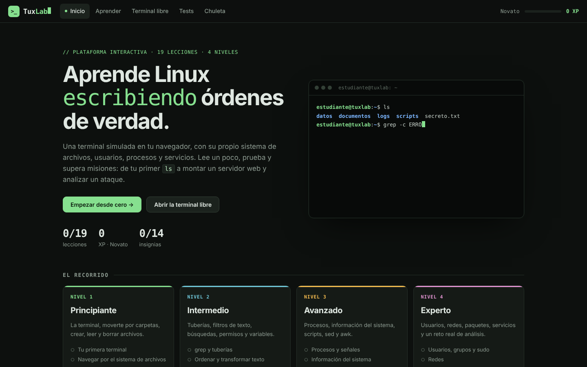
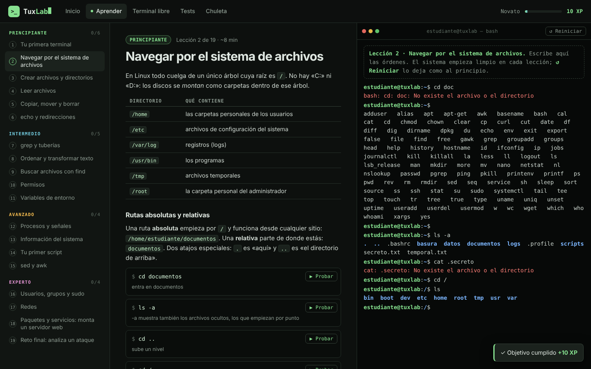
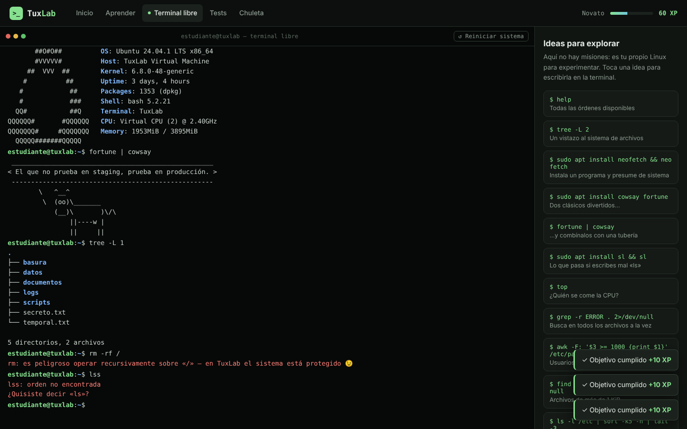

# 🐧 TuxLab — Aprende Linux escribiendo órdenes de verdad

Plataforma interactiva para aprender Linux **en el navegador**, desde cero hasta nivel experto. Incluye una terminal bash simulada con su propio sistema de archivos, usuarios, procesos, paquetes y servicios. No hace falta instalar nada.



## Qué incluye

- **19 lecciones en 4 niveles**, con teoría breve, ejemplos que se envían a la terminal con un clic y misiones que se comprueban solas.
  - **Principiante:** la terminal, navegación, crear/leer/copiar/mover/borrar archivos, redirecciones.
  - **Intermedio:** `grep` y tuberías, `sort`/`uniq`/`cut`/`tr`, `find`, permisos, variables de entorno.
  - **Avanzado:** procesos y señales, información del sistema, scripts, `sed` y `awk`.
  - **Experto:** usuarios y `sudo`, redes, `apt` y `systemctl` (montar un servidor nginx) y un reto final de análisis de logs.
- **Terminal libre** con unas 118 órdenes: historial (↑/↓), autocompletado (Tab), tuberías, redirecciones, permisos, `sudo` y errores como en bash.
- **Tests por nivel** con explicación de cada respuesta.
- **Chuleta** de órdenes con buscador.
- **XP, rangos e insignias.** El progreso se guarda en el navegador (`localStorage`).



## Uso

Abre `index.html` en cualquier navegador moderno. Es un único archivo autocontenido.

Para publicarlo con **GitHub Pages**: *Settings → Pages → Deploy from a branch → `main` / root*.

## Desarrollo

El código fuente está en `src/`:

| Archivo | Contenido |
|---|---|
| `src/engine.js` | Motor de la shell simulada: sistema de archivos, tokenizador, tuberías, órdenes, mini `awk` y `sed` |
| `src/content.js` | Lecciones, misiones, tests, insignias y chuleta |
| `src/ui.js` | Interfaz: terminal, vistas, progreso |
| `src/style.css`, `src/body.html` | Estilos y estructura |

```bash
python3 build.py   # genera index.html a partir de src/
node test.js       # ejecuta la solución de cada lección y verifica que todas las misiones se cumplen
```

## Limitaciones

- No hay editores interactivos (`nano`, `vim`): los archivos se escriben con `echo` y redirecciones.
- Los scripts no admiten bucles ni condicionales.
- La red es simulada: `ping` y `curl` responden a `localhost`, `servidor` o `example.com`.


